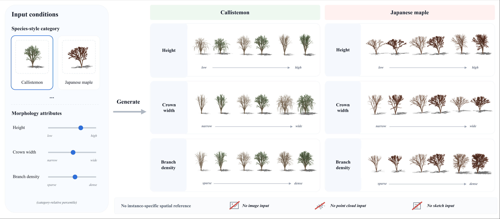

# Attribute-Conditioned Explicit 3D Tree Skeleton Generation

**Lin Cui · Di Wang**

Xi'an Jiaotong University

Implementation for *Attribute-Conditioned Explicit 3D Tree Skeleton Generation*.
Given a species-style category and three continuous morphology attributes, the
model generates a 3D skeleton with explicit vertices and branch connectivity.



## Overview

The framework combines a shared segment tokenizer, a coarse-to-fine
autoregressive generator, and deterministic Direct assembly. Height, crown width,
and branch density are specified as category-relative percentiles and enter the
generator through condition tokens and feature-wise modulation.

The dataset contains 12,000 synthetic skeletons from four categories:
Callistemon, Japanese maple, weeping willow, and white birch.

## Installation

Use Python 3.10 or later and install a PyTorch build compatible with your CUDA
environment. From the project directory:

```bash
python -m venv .venv
source .venv/bin/activate
python -m pip install -e .
python -m tree_skeleton --help
```

The package pins `x-transformers==1.40.2` and
`vector-quantize-pytorch==1.23.2`. CUDA is used for the generation commands below.

## Dataset

**Download:** [Google Drive](https://drive.google.com/file/d/1L9ynZABtgg3uYCbHRt4CoI6uFpYzxwSl/view)

All release files and their [SHA-256 checksums](https://drive.google.com/file/d/1pZDxBN0iqKvY6l86-74GiC2lZcP1OYUz/view) are available in the [Google Drive folder](https://drive.google.com/open?id=1uXMnkqAD4Uo2xy1i_hk4juqekBkt669M).

Download `four_species_12000_dataset.zip` and extract it in the project directory:

```bash
unzip /path/to/four_species_12000_dataset.zip -d .
```

The dataset is organized as follows:

```text
external_data/
├── four_species_12000_species_global_strict.pkl
├── four_species_12000_attributes_v2p2.json
├── four_species_12000_split_seed20260805.json
├── coordinate_protocol.json
├── priors/
│   ├── callistemon_training_morphology_prior.json
│   ├── japanese_maple_training_morphology_prior.json
│   ├── weeping_willow_training_morphology_prior.json
│   ├── white_birch_training_morphology_prior.json
│   └── manifest.json
├── README.txt
└── SHA256SUMS
```

Each skeleton contains `vertices` (N × 3) and `lines` (E × 2). The attribute JSON
provides morphology measurements and condition values; the split JSON defines
the fixed training, validation, and test partitions.

The data may also be stored elsewhere: replace `--data-root external_data` in
the commands below with `--data-root /path/to/external_data`.

| Split | Per category | Total |
| --- | ---: | ---: |
| Training | 2,400 | 9,600 |
| Validation | 300 | 1,200 |
| Test | 300 | 1,200 |

The configurations require category coordinate scales fitted only on the
2,400 training trees per category. `coordinate_protocol.json` records the
fitting partition and frozen scale coefficients. Attribute percentiles and
Direct attachment priors are also fitted on training rows only.

Verify the dataset before running experiments:

```bash
python -m tree_skeleton verify-data \
  --config configs/generator.yaml --data-root external_data
```

### Generating datasets with Blender

We also release a [single-file Blender script](scripts/blender_generate_species_dataset.py)
to help users generate synthetic tree skeleton datasets. The script provides a
white-birch example with an embedded Sapling preset and reads per-tree parameters
from the included [3,000-row CSV manifest](scripts/white_birch_3000_manifest.csv).

Enable the Sapling Tree Gen add-on in Blender, keep
`white_birch_3000_manifest.csv` beside the script, and run it in the Scripting
workspace. Set `GUI_MODE = "full"` to process all 3,000 manifest rows. The script
exports skeleton vertex coordinates, branch connections, and a generation log
to `white_birch_raw_3000/` beside the script. Command-line usage is documented
at the top of the script.

The manifest's target levels describe planned parameter controls. Final
morphology labels should be measured from the generated skeleton geometry.

## Pretrained Models

**Download:** [Tokenizer](https://drive.google.com/file/d/1NRnw92s8U-B3Nmv3SB2P2NWAv-emsgSe/view) · [Generator](https://drive.google.com/file/d/1dD3_IHKqZE7nEs_ByGyOWBNR2pn0Zehl/view)

Download the two checkpoints separately from the dataset and place them at the
paths below:

| Model | Checkpoint |
| --- | --- |
| Shared segment tokenizer | `checkpoints/tokenizer/best.pth` |
| Conditional skeleton generator | `checkpoints/generator/best.pth` |

Use `configs/tokenizer.yaml` for the tokenizer and `configs/generator.yaml` for
the generator. The generator checkpoint includes its frozen tokenizer, so
generation only needs the generator weight file. The separate tokenizer
checkpoint is used when training a new generator. Data and weights are hosted
separately and are excluded from this repository.

## Training

Train the shared tokenizer, then train the conditional generator with the frozen
tokenizer. Both configurations use training-only coordinate scales.

| Stage | Processes | Batch per process | Accumulation | Effective batch |
| --- | ---: | ---: | ---: | ---: |
| Shared tokenizer | 2 | 4 | 2 | 16 |
| Conditional generator (AR) | 2 | 2 | 2 | 8 |

```bash
# Stage 1: segment tokenizer
accelerate launch --num_processes 2 --mixed_precision bf16 \
  -m tree_skeleton train --config configs/tokenizer.yaml \
  --data-root external_data --output outputs/tokenizer

# Stage 2: conditional generator
accelerate launch --num_processes 2 --mixed_precision fp16 \
  -m tree_skeleton train --config configs/generator.yaml \
  --data-root external_data --tokenizer outputs/tokenizer/best.pth \
  --output outputs/main
```

Add `--resume auto` to resume a run created by this package. The tokenizer runs
for 115,200 optimizer-loop updates; the generator runs for 216,000 successful
optimizer updates, with full validation every 2,400 updates. Each stage writes
`best.pth` and `best_metrics.json` in its output directory, selected by validation
loss. A fresh full training run has not yet been verified against the manuscript
tables.

## Generation

Create the fixed category-and-attribute requests and generate skeletons using
the pretrained model:

```bash
python -m tree_skeleton requests \
  --config configs/generator.yaml --data-root external_data \
  --protocol marginal7 --output outputs/marginal7_requests.json

python -m tree_skeleton generate \
  --config configs/generator.yaml --data-root external_data \
  --checkpoint checkpoints/generator/best.pth \
  --requests outputs/marginal7_requests.json \
  --priors external_data/priors --output outputs/marginal7
```

The outputs include `raw_tree.npz` and `direct_tree.npz`, together with generation
and assembly records. Marginal-7 varies one morphology attribute at a time while
holding the other two at the center condition. Use `--protocol q4` with new output
paths to generate requests matched to the held-out test conditions.

## Evaluation

```bash
python -m tree_skeleton evaluate \
  --config configs/generator.yaml --data-root external_data \
  --requests outputs/marginal7_requests.json --generated outputs/marginal7 \
  --variant direct --output outputs/marginal7_metrics.json
```

Evaluation reports morphology target errors, composite hit rates, and topology
validity. Q4 additionally evaluates category-level distribution quality with
MMD-CD, COV-CD, and 1-NNA-CD. Use `--variant raw` to evaluate the raw segment
outputs.

Chamfer evaluation samples 1,024 points uniformly along total edge arc length
and sums the two directional mean squared nearest-point distances, without
GT-dependent alignment. Attribute and topology-plus-attribute hit rates use all
planned requests as their denominator. Set distances use measurable completed
outputs and are accompanied by the failure rate. Marginal-7 shares 32 generation
seeds across conditions and categories.

## Code Structure

| Directory | Contents |
| --- | --- |
| `tree_skeleton/nn/` | Independent graph encoding, endpoint quantization, morphology conditioning, and generation components |
| `tree_skeleton/data/` | Dataset loading, fixed splits, and condition preparation |
| `tree_skeleton/training/` | Two-stage training, validation, and checkpoint management |
| `tree_skeleton/geometry/` | Direct assembly, morphology measurement, and graph operations |
| `tree_skeleton/experiments/` | Evaluation requests, controllability, and set quality |
| `configs/` | Tokenizer and generator configurations with training-only coordinate scales; AR effective batch size is 8 |

The Python model API exposes `TreeSegmentTokenizer` and `AttributeTreeGenerator`
from `tree_skeleton.nn`.

## Citation

Please cite the associated manuscript if you use this code or dataset:

```bibtex
@misc{cui_attribute_tree_skeleton,
  title  = {Attribute-Conditioned Explicit 3D Tree Skeleton Generation},
  author = {Cui, Lin and Wang, Di},
  note   = {Research manuscript}
}
```

## Acknowledgements

This implementation uses PyTorch, PyTorch Geometric, Accelerate,
`x-transformers`, `vector-quantize-pytorch`, `gateloop-transformer`,
`local-attention`, `ema-pytorch`, `pytorch-custom-utils`, `einops`, and `einx`,
under their respective licenses.

## License

```text
MIT License

Copyright (c) 2025 Xueqi Ma

Permission is hereby granted, free of charge, to any person obtaining a copy
of this software and associated documentation files (the "Software"), to deal
in the Software without restriction, including without limitation the rights
to use, copy, modify, merge, publish, distribute, sublicense, and/or sell
copies of the Software, and to permit persons to whom the Software is
furnished to do so, subject to the following conditions:

The above copyright notice and this permission notice shall be included in all
copies or substantial portions of the Software.

THE SOFTWARE IS PROVIDED "AS IS", WITHOUT WARRANTY OF ANY KIND, EXPRESS OR
IMPLIED, INCLUDING BUT NOT LIMITED TO THE WARRANTIES OF MERCHANTABILITY,
FITNESS FOR A PARTICULAR PURPOSE AND NONINFRINGEMENT. IN NO EVENT SHALL THE
AUTHORS OR COPYRIGHT HOLDERS BE LIABLE FOR ANY CLAIM, DAMAGES OR OTHER
LIABILITY, WHETHER IN AN ACTION OF CONTRACT, TORT OR OTHERWISE, ARISING FROM,
OUT OF OR IN CONNECTION WITH THE SOFTWARE OR THE USE OR OTHER DEALINGS IN THE
SOFTWARE.
```
